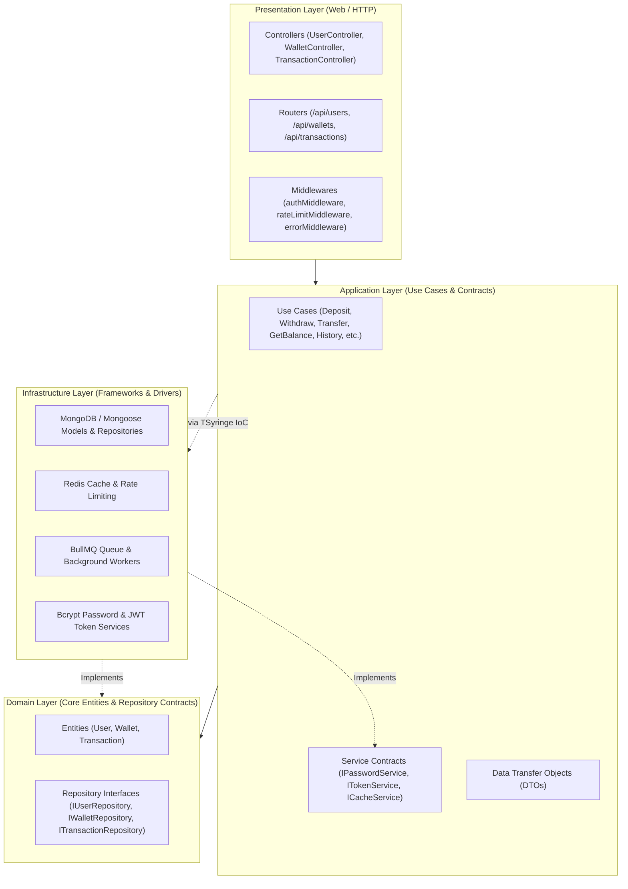

# 💳 Multi-Currency Digital Wallet & Transaction Engine

A robust, enterprise-grade digital wallet system built with **Node.js**, **Express 5**, **TypeScript**, **MongoDB**, **Redis**, and **BullMQ**. Designed following **Clean Architecture** and **SOLID Principles**, the system delivers safe concurrent financial transactions, real-time currency conversion, velocity-based fraud prevention, idempotency safeguards, and distributed rate limiting.

---

## 📑 Table of Contents

- [Architectural Overview](#-architectural-overview)
- [Clean Architecture Breakdown](#-clean-architecture-breakdown)
- [SOLID Principles Implementation](#-solid-principles-implementation)
- [Core Features](#-core-features)
- [API Reference](#-api-reference)
- [Project Directory Structure](#-project-directory-structure)
- [Tech Stack](#-tech-stack)
- [Setup & Installation](#-setup--installation)
- [Available Scripts](#-available-scripts)

---

## 🏛 Architectural Overview

The application follows **Clean Architecture** (Ports and Adapters / Hexagonal Architecture), strictly separating business logic from external frameworks, databases, and network transports.



### The Dependency Rule
Dependencies only point **inwards**:
- **Domain Layer** has zero external dependencies.
- **Application Layer** depends strictly on Domain entities and repository contracts.
- **Infrastructure Layer** and **Presentation Layer** depend inward onto Application and Domain abstractions.
- Cross-layer dependencies are resolved at runtime through **Dependency Injection** using **TSyringe**.

---

## 🧱 Clean Architecture Breakdown

| Layer | Directory | Responsibility | Components |
|---|---|---|---|
| **Domain** | `src/domain/` | Enterprise business entities and repository contracts. Independent of databases, frameworks, or UI. | `User.ts`, `Wallet.ts`, `Transaction.ts`, `IUserRepository.ts`, `IWalletRepository.ts`, `ITransactionRepository.ts` |
| **Application** | `src/application/` | Orchestrates application business rules via isolated use cases. Defines boundary interfaces for services. | `usecases/*` (`DepositUseCase`, `WithdrawUseCase`, `TransferUseCase`, `GetTransactionHistoryUseCase`, etc.), `interfaces/*` (`ICacheService`, `IPasswordService`, `ITokenService`, `IExchangeRateService`) |
| **Infrastructure** | `src/infrastructure/` | Implements domain and application interfaces using external libraries, databases, and services. | Mongoose Models (`UserModel`, `WalletModel`, `TransactionModel`), Repositories (`UserRepository`, `WalletRepository`, `TransactionRepository`), Redis Cache (`RedisCacheService`), BullMQ (`exchangeRateQueue`, `exchangeRateWorker`), External Services (`PasswordService`, `TokenService`) |
| **Presentation** | `src/presentation/` | HTTP transport boundary. Receives client requests, validates DTO inputs, invokes use cases, formats responses. | `UserController`, `WalletController`, `TransactionController`, `authMiddleware`, `rateLimitMiddleware`, `errorMiddleware`, Express routers |
| **Composition Root** | `src/container/` | Inversion of Control (IoC) registry configuring token bindings and dependency life-cycles. | `tokens.ts`, `container.ts` |

---

## 🧩 SOLID Principles Implementation

Each of the five SOLID design principles is systematically applied throughout the codebase:

### 1. Single Responsibility Principle (SRP)
> *"A class should have one, and only one, reason to change."*

- **Isolated Use Cases**: Rather than a monolithic `WalletService` handling deposits, withdrawals, transfers, and balance checks, each operation is isolated into its own dedicated class:
  - `DepositUseCase`: Handles deposit logic, exchange rates, fraud validation, and transaction logs.
  - `WithdrawUseCase`: Handles balance sufficiency checks, daily limits, and debit operations.
  - `TransferUseCase`: Orchestrates peer-to-peer balance debits, credits, currency conversions, and transaction recording.
  - `GetTransactionHistoryUseCase`: Resolves user wallets, fetches transaction records, formats credit/debit directions, and calculates pagination.
- **Dedicated Infrastructure Services**:
  - `PasswordService`: Strictly responsible for bcrypt hashing and password comparison.
  - `TokenService`: Exclusively generates and validates JSON Web Tokens.
  - `RedisCacheService`: Exclusively manages key-value caching with expiration.

```typescript
// src/application/usecases/transfer/TransferUseCase.ts
@injectable()
export class TransferUseCase implements ITransferUseCase {
  // Only changes if the fund transfer business rules change
  async execute(dto: TransferDto): Promise<TransferResponseDto> { ... }
}
```

---

### 2. Open/Closed Principle (OCP)
> *"Software entities should be open for extension, but closed for modification."*

- **Extensible Feature Set**: Adding a new transaction type (such as `TransferUseCase` or `GetTransactionHistoryUseCase`) required zero modifications to existing classes like `DepositUseCase` or `WithdrawUseCase`.
- **Pluggable Repositories & Services**: Business rules in use cases rely exclusively on interfaces (`IWalletRepository`, `ICacheService`). If MongoDB is swapped with PostgreSQL or Redis is replaced with Memcached, the Application and Domain layers remain 100% untouched.

```typescript
// Adding a new UseCase does not modify existing UseCases:
export interface ITransferUseCase {
  execute(dto: TransferDto): Promise<TransferResponseDto>;
}
```

---

### 3. Liskov Substitution Principle (LSP)
> *"Subtypes must be substitutable for their base types without altering program correctness."*

- **Strict Interface Adherence**: Concrete implementations in `src/infrastructure/` conform exactly to domain contracts.
  - `WalletRepository` implements `IWalletRepository`.
  - `TransactionRepository` implements `ITransactionRepository`.
  - `RedisCacheService` implements `ICacheService`.
- Any use case accepting `IWalletRepository` can transparently use `WalletRepository` in production or an in-memory mock repository during unit testing without any change in behavior.

```typescript
// Domain Contract:
export interface IWalletRepository {
  save(wallet: CreateWalletInput): Promise<Wallet>;
  findById(id: string): Promise<Wallet | null>;
  findByUserId(userId: string): Promise<Wallet | null>;
  updateBalance(walletId: string, amount: number): Promise<Wallet | null>;
}

// Infrastructure Implementation satisfies the contract completely:
@injectable()
export class WalletRepository implements IWalletRepository {
  async updateBalance(walletId: string, amount: number): Promise<Wallet | null> { ... }
}
```

---

### 4. Interface Segregation Principle (ISP)
> *"Clients should not be forced to depend upon interfaces that they do not use."*

- **Targeted, Granular Interfaces**: Clients interact only with the specific methods they require.
  - Instead of forcing `TransactionController` to depend on a giant interface containing 20 administrative and wallet methods, it depends only on `IDepositUseCase`, `IWithdrawUseCase`, `ITransferUseCase`, and `IGetTransactionHistoryUseCase`.
  - `IPasswordService` exposes only `hash` and `compare`.
  - `ITokenService` exposes only `signToken` and `verifyToken`.

```typescript
// Granular, segregated use case interfaces:
export interface IDepositUseCase {
  execute(dto: DepositDto): Promise<DepositResponseDto>;
}

export interface ITransferUseCase {
  execute(dto: TransferDto): Promise<TransferResponseDto>;
}

export interface IGetTransactionHistoryUseCase {
  execute(dto: GetTransactionHistoryDto): Promise<TransactionHistoryResponseDto>;
}
```

---

### 5. Dependency Inversion Principle (DIP)
> *"High-level modules should not depend on low-level modules. Both should depend on abstractions."*

- High-level business logic (Use Cases in `src/application/`) never imports concrete Mongoose models, Redis clients, or Bcrypt modules.
- Both layers depend on abstract TypeScript interfaces located in `src/domain/repositories/` and `src/application/interfaces/`.
- Concrete implementations are bound at application startup in `src/container/container.ts` and injected via `@inject(DI_TOKENS.*)`.

```typescript
// High-level module depends on abstractions:
@injectable()
export class TransferUseCase implements ITransferUseCase {
  constructor(
    @inject(DI_TOKENS.walletRepository)
    private readonly walletRepository: IWalletRepository, // Abstract interface
    @inject(DI_TOKENS.transactionRepository)
    private readonly transactionRepository: ITransactionRepository, // Abstract interface
    @inject(DI_TOKENS.getExchangeRatesUseCase)
    private readonly getExchangeRatesUseCase: IGetExchangeRatesUseCase,
    @inject(DI_TOKENS.validateFraudUseCase)
    private readonly validateFraudUseCase: IValidateFraudUseCase,
  ) {}
}
```

---

## ⚡ Core Features

### 1. Multi-Currency Support & Automated Exchange Rates
- Support for multi-currency deposits and transfers (e.g., depositing in `USD` or `EUR` into an `INR` base wallet).
- Automated daily exchange rate sync via **BullMQ** scheduler and worker (`exchangeRateScheduler.ts`, `exchangeRateWorker.ts`).
- Exchange rates are cached in **Redis** with configurable TTL (`CURRENCY_CACHE_TTL`).

### 2. Atomic Balance Updates & Concurrency Safety
- Prevents race conditions and double-spending without expensive table-level locks.
- Uses MongoDB conditional atomic updates (`$inc` coupled with `{ balance: { $gte: Math.abs(amount) } }`).

### 3. Idempotency Guarantees
- Deposits, withdrawals, and transfers accept an `idempotencyKey`.
- If a client retries a request with the same idempotency key (e.g., due to network timeout), the system returns the existing transaction result instead of executing a duplicate charge.

### 4. Velocity-Based Fraud Prevention
- `AddFraudUseCase` and `ValidateFraudUseCase` monitor deposit velocity using Redis sliding window keys.
- If repeated large deposits exceed thresholds within a rolling window (`FRAUD_CONFIG`), the account is automatically flagged, rejecting subsequent transactions.

### 5. Dual-Tier Distributed Rate Limiting
- Built on `rate-limiter-flexible` and Redis:
  - **Per-minute limit**: 20 requests/minute per authenticated user.
  - **Per-hour limit**: 1000 requests/hour per authenticated user.
- Responds with HTTP `429 Too Many Requests` when limits are exceeded.

### 6. Transaction History with Direction & Timestamps
- Queries user transactions by wallet with pagination (`page`, `limit`) and type filtering (`deposit`, `withdrawal`, `transfer`).
- Automatically resolves transaction directions relative to the user:
  - `credit`: Deposits and incoming transfers.
  - `debit`: Withdrawals and outgoing transfers.

### 7. Graceful Shutdown
- Catches `SIGINT` and `SIGTERM` signals.
- Safely terminates HTTP connections, flushes pending requests, closes MongoDB connections, closes Redis clients, and pauses BullMQ workers.

---

## 📡 API Reference

Base URL: `http://localhost:3000`

### 1. Authentication Endpoints

#### Register a New User
- **`POST /api/users/signup`**
- **Public**
- **Request Body:**
```json
{
  "name": "John Doe",
  "email": "john@example.com",
  "password": "SecurePassword123!",
  "preferredCurrency": "INR"
}
```
- **Response (`201 Created`):**
```json
{
  "message": "User registered successfully",
  "data": {
    "user": {
      "id": "670f...",
      "name": "John Doe",
      "email": "john@example.com",
      "preferredCurrency": "INR"
    },
    "token": "eyJhbGciOiJIUzI1NiIsInR5cCI6IkpXVCJ9..."
  }
}
```

#### User Sign In
- **`POST /api/users/signin`**
- **Public**
- **Request Body:**
```json
{
  "email": "john@example.com",
  "password": "SecurePassword123!"
}
```
- **Response (`200 OK`):**
```json
{
  "message": "Login successful",
  "data": {
    "user": {
      "id": "670f...",
      "name": "John Doe",
      "email": "john@example.com"
    },
    "token": "eyJhbGciOiJIUzI1NiIsInR5cCI6IkpXVCJ9..."
  }
}
```

#### Get Current User Profile
- **`GET /api/users/me`**
- **Requires:** `Authorization: Bearer <token>`
- **Rate Limited:** Yes
- **Response (`200 OK`):**
```json
{
  "message": "User fetched successfully",
  "data": {
    "id": "670f...",
    "name": "John Doe",
    "email": "john@example.com",
    "role": "user"
  }
}
```

---

### 2. Wallet Endpoints

#### Check Wallet Balance
- **`GET /api/wallets/balance`**
- **Requires:** `Authorization: Bearer <token>`
- **Response (`200 OK`):**
```json
{
  "message": "Wallet balance fetched successfully",
  "data": {
    "walletId": "670f...",
    "balance": 2500.50,
    "currency": "INR"
  }
}
```

---

### 3. Transaction Endpoints

#### Deposit Funds
- **`POST /api/transactions/deposit`**
- **Requires:** `Authorization: Bearer <token>`
- **Rate Limited:** Yes
- **Request Body:**
```json
{
  "amount": 500,
  "currency": "INR",
  "idempotencyKey": "dep-uuid-12345"
}
```
- **Response (`201 Created`):**
```json
{
  "message": "Deposit successful",
  "data": {
    "transaction": {
      "transactionId": "TXN-17290...",
      "idempotencyKey": "dep-uuid-12345",
      "type": "deposit",
      "status": "completed",
      "amount": 500,
      "currency": "INR",
      "createdAt": "2026-10-16T10:00:00.000Z"
    },
    "wallet": {
      "id": "670f...",
      "balance": 3000.50,
      "currency": "INR"
    }
  }
}
```

#### Withdraw Funds
- **`POST /api/transactions/withdraw`**
- **Requires:** `Authorization: Bearer <token>`
- **Rate Limited:** Yes
- **Request Body:**
```json
{
  "amount": 200,
  "currency": "INR",
  "idempotencyKey": "wth-uuid-12345"
}
```
- **Response (`200 OK`):**
```json
{
  "message": "Withdrawal successful",
  "data": {
    "transaction": {
      "transactionId": "TXN-17290...",
      "type": "withdrawal",
      "status": "completed",
      "amount": 200,
      "currency": "INR"
    },
    "wallet": {
      "id": "670f...",
      "balance": 2800.50,
      "currency": "INR"
    }
  }
}
```

#### Transfer Funds to Another User
- **`POST /api/transactions/transfer`**
- **Requires:** `Authorization: Bearer <token>`
- **Rate Limited:** Yes
- **Request Body:**
```json
{
  "recipientUserId": "670fa92b4512e9876543210f",
  "amount": 150,
  "currency": "INR",
  "idempotencyKey": "trf-uuid-12345"
}
```
- **Response (`200 OK`):**
```json
{
  "message": "Transfer successful",
  "data": {
    "transaction": {
      "transactionId": "TXN-17290...",
      "type": "transfer",
      "status": "completed",
      "fromWalletId": "670f... (Sender)",
      "toWalletId": "670f... (Recipient)",
      "amount": 150,
      "currency": "INR"
    },
    "senderWallet": {
      "id": "670f...",
      "balance": 2650.50,
      "currency": "INR"
    },
    "recipientWallet": {
      "id": "670f...",
      "balance": 1150.00,
      "currency": "INR"
    }
  }
}
```

#### View Transaction History
- **`GET /api/transactions/history`** or **`GET /api/transactions/history/:userId`**
- **Requires:** `Authorization: Bearer <token>`
- **Rate Limited:** Yes
- **Query Parameters:**
  - `page` *(optional, default: 1)*
  - `limit` *(optional, default: 10)*
  - `type` *(optional: `deposit` | `withdrawal` | `transfer`)*
- **Response (`200 OK`):**
```json
{
  "message": "Transaction history fetched successfully",
  "data": {
    "transactions": [
      {
        "id": "670f...",
        "transactionId": "TXN-172908...",
        "type": "transfer",
        "direction": "debit",
        "amount": 150,
        "currency": "INR",
        "status": "completed",
        "counterpartyWalletId": "670fa92...",
        "timestamp": "2026-10-16T10:15:30.123Z"
      },
      {
        "id": "670e...",
        "transactionId": "TXN-172907...",
        "type": "deposit",
        "direction": "credit",
        "amount": 500,
        "currency": "INR",
        "status": "completed",
        "counterpartyWalletId": null,
        "timestamp": "2026-10-16T09:30:15.456Z"
      }
    ],
    "pagination": {
      "page": 1,
      "limit": 10,
      "total": 2,
      "totalPages": 1
    }
  }
}
```

---

## 📁 Project Directory Structure

```plaintext
wallet_system/
├── dist/                               # Compiled JavaScript output (from tsc)
├── src/
│   ├── app.ts                          # Express application configuration & middlewares
│   ├── server.ts                       # Entry point, DB connection, queue startup, graceful shutdown
│   ├── constants/                      # Fixed business constants
│   │   ├── exchangeRates.ts            # Default exchange rate fallbacks
│   │   ├── fraud.ts                    # Fraud velocity thresholds & TTL configs
│   │   ├── httpStatus.ts               # HTTP Status Code constants
│   │   ├── messages.ts                 # Standardized system & error messages
│   │   └── transaction.ts              # Daily and per-transaction monetary limits
│   ├── container/                      # TSyringe IoC Container
│   │   ├── container.ts                # Token bindings & class registrations
│   │   └── tokens.ts                   # Symbol-based DI Tokens
│   ├── domain/                         # Enterprise Core (Clean Architecture innermost layer)
│   │   ├── entities/                   # User, Wallet, Transaction interfaces & types
│   │   └── repositories/               # Pure repository contracts (IUserRepo, IWalletRepo, etc.)
│   ├── application/                    # Application Business Rules
│   │   ├── interfaces/                 # Abstraction contracts for services (ICache, IPassword, etc.)
│   │   └── usecases/                   # Isolated Use Case modules
│   │       ├── addFraud/               # Evaluates and records suspicious deposit velocity
│   │       ├── validateFraud/          # Validates if user account is flagged
│   │       ├── createWallet/           # Creates initial wallet upon user registration
│   │       ├── getBalance/             # Fetches wallet balance
│   │       ├── deposit/                # Executes fund deposits with currency conversion
│   │       ├── withdraw/               # Executes fund withdrawals with balance validations
│   │       ├── transfer/               # Executes peer-to-peer transfers with currency conversion
│   │       ├── getTransactionHistory/  # Formats user transactions with credit/debit direction
│   │       ├── getExchangeRates/       # Retrieves exchange rates with cache fallback
│   │       ├── updateExchangeRates/    # Synchronizes rates from remote API
│   │       ├── signUp/                 # Handles registration and password hashing
│   │       ├── signIn/                 # Handles authentication and JWT token generation
│   │       └── getMe/                  # Retrieves authenticated user details
│   ├── infrastructure/                 # External Adapters & Implementations
│   │   ├── config/                     # Database, Redis, and Rate Limiter setup
│   │   ├── database/
│   │   │   ├── models/                 # Mongoose Schemas (UserModel, WalletModel, TransactionModel)
│   │   │   └── repositories/           # Concrete Repository implementations
│   │   ├── queue/                      # BullMQ queue definitions
│   │   ├── workers/                    # BullMQ background workers
│   │   ├── jobs/                       # Cron & scheduled recurring job definitions
│   │   └── services/                   # Concrete service implementations (Bcrypt, JWT, Redis)
│   ├── presentation/                   # Web / HTTP Transport Layer
│   │   ├── controllers/                # UserController, WalletController, TransactionController
│   │   ├── middleware/                 # authMiddleware, rateLimitMiddleware, errorMiddleware
│   │   └── routes/                     # userRouter, walletRouter, transactionRouter
│   └── utils/                          # Common helpers (env, gracefulShutdown, identifiers)
├── .env.example                        # Template for environment variables
├── package.json                        # Dependencies, scripts, and package metadata
├── tsconfig.json                       # TypeScript compiler options (NodeNext, Strict mode)
└── README.md                           # Project documentation
```

---

## 🛠 Tech Stack

- **Runtime & Language**: [Node.js](https://nodejs.org/) (ES Modules), [TypeScript](https://www.typescriptlang.org/) (Strict Mode, `NodeNext`)
- **Web Framework**: [Express 5](https://expressjs.com/)
- **Dependency Injection**: [TSyringe](https://github.com/microsoft/tsyringe) (IoC Container)
- **Primary Database**: [MongoDB](https://www.mongodb.com/) via [Mongoose](https://mongoosejs.com/)
- **Cache & Message Broker**: [Redis](https://redis.io/) via [ioredis](https://github.com/redis/ioredis)
- **Job Scheduling & Background Queues**: [BullMQ](https://bullmq.io/)
- **Rate Limiting**: [rate-limiter-flexible](https://github.com/animir/node-rate-limiter-flexible)
- **Security & Cryptography**: [bcrypt](https://github.com/kelektiv/node.bcrypt.js), [jsonwebtoken](https://github.com/auth0/node-jsonwebtoken)

---

## 🚀 Setup & Installation

### Prerequisites
- **Node.js** `>= 18.0.0`
- **npm** `>= 9.0.0`
- **MongoDB** running locally or a MongoDB Atlas URI
- **Redis** running locally (port `6379`) or a hosted Redis instance

### 1. Clone the Repository
```bash
git clone https://github.com/AbhiramTB/wallet-system.git
cd wallet-system
```

### 2. Install Dependencies
```bash
npm install
```

### 3. Configure Environment Variables
Copy `.env.example` to `.env` and fill in your configuration:
```bash
cp .env.example .env
```

Ensure `.env` contains:
```env
PORT=3000
DB_URL=mongodb://localhost:27017/wallet_system
JWT_SECRET=your_super_secret_jwt_key
ACCESS_TOKEN_SECRET=your_access_token_secret
REFRESH_TOKEN_SECRET=your_refresh_token_secret
JWT_EXPIRES_IN=1d
REDIS_HOST=localhost
REDIS_PORT=6379
EXCHANGE_RATE_API_URL=https://open.er-api.com/v6/latest
DEFAULT_BASE_CURRENCY=INR
CURRENCY_CACHE_TTL=86400
```

---

## 🏃 Available Scripts

| Command | Description |
|---|---|
| `npm run dev` | Starts the server in development mode with hot-reloading (`tsx watch src/server.ts`) |
| `npm run build` | Compiles TypeScript source files into native JavaScript inside the `./dist` directory |
| `npm start` | Runs the compiled production code using `node dist/server.js` |
| `npm test` | Placeholder for test suite execution |

---
